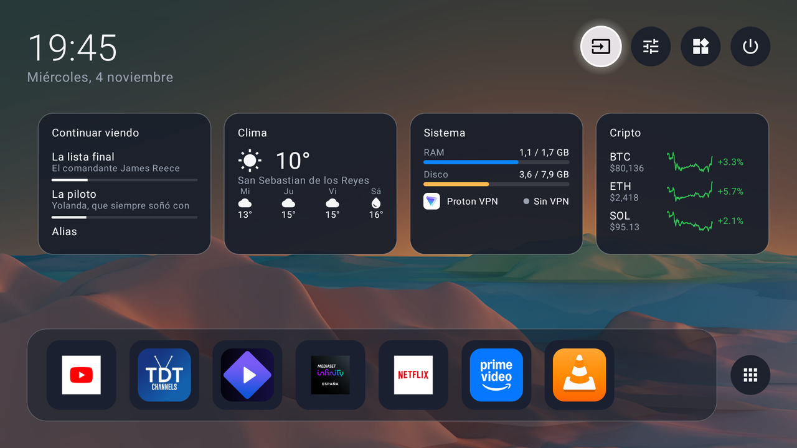
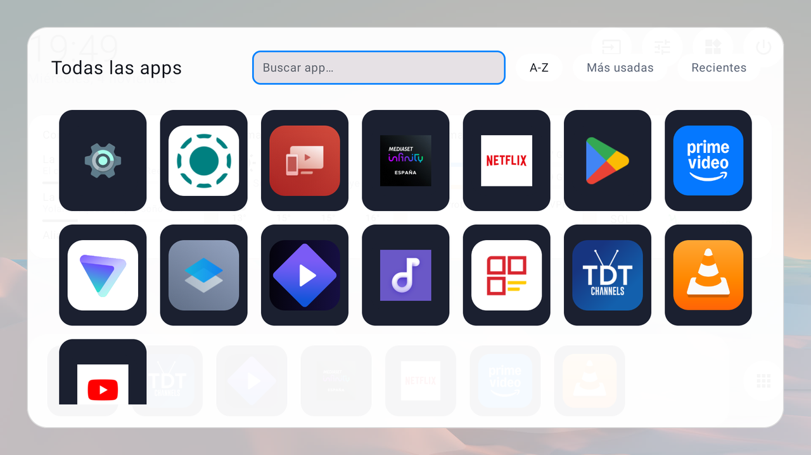
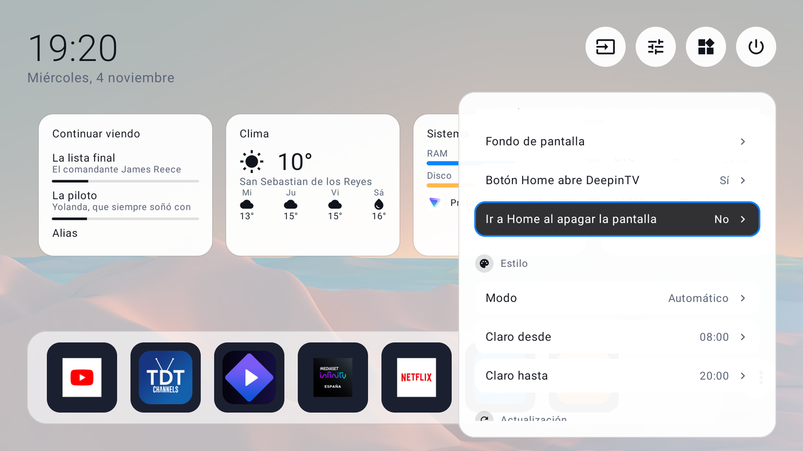
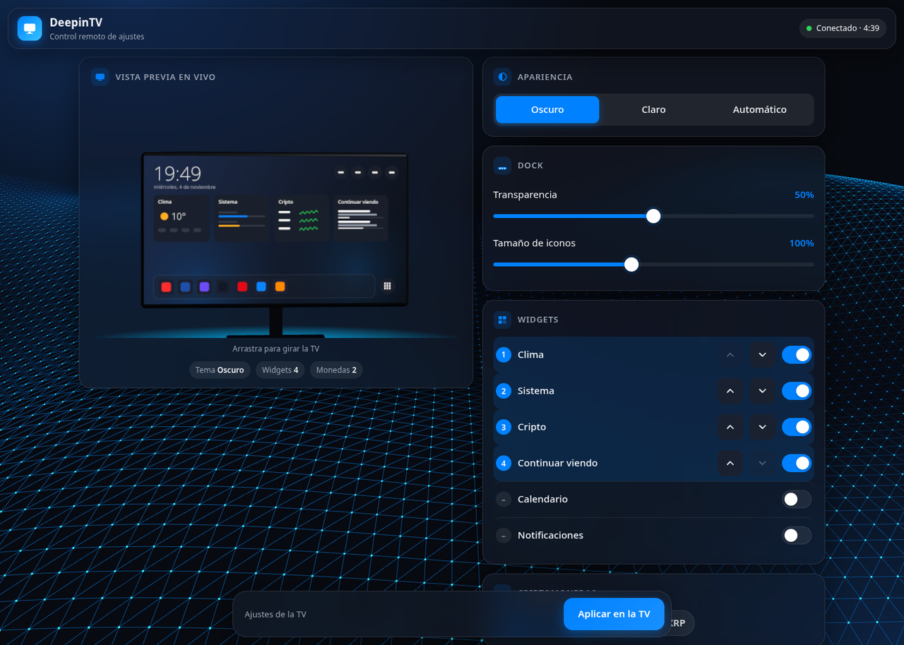
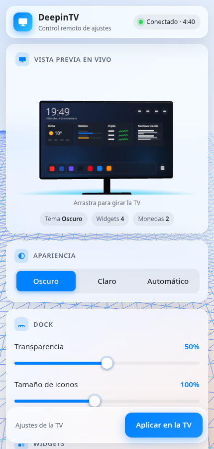

<p align="center">
  <picture>
    <source media="(prefers-color-scheme: dark)" srcset="docs/assets/banner-dark.es.svg">
    
  </picture>
</p>

<p align="center">
  <a href="../../releases"></a>
  
  
  
  <a href="LICENSE"></a>
</p>

<p align="center">
  <a href="README.md">English</a> · <b>Español</b>
</p>

<p align="center">
  Tarjetas de cristal esmerilado, un dock inferior y un centro de control a la derecha —<br>
  el aspecto del escritorio <a href="https://www.deepin.org">Deepin</a>, hecho launcher nativo para televisores con poca RAM.
</p>

<p align="center">
  <picture>
    <source media="(prefers-color-scheme: light)" srcset="docs/screenshots/home-light.png">
    
  </picture>
</p>

<br>

## Funciones

| | | |
|:--|:--|:--|
| 🏠 **Inicio**<br><sub>Reloj, botones rápidos y un dock de favoritos editable.</sub> | 🔎 **Cajón de apps**<br><sub>Búsqueda por prefijo, palabra o iniciales (“gm” → Google Maps). A–Z, más usadas, recientes.</sub> | 🔌 **Entradas**<br><sub>Los nombres que diste a cada fuente, un icono por conector y qué hay conectado.</sub> |
| 🧩 **Widgets**<br><sub>Clima, calendario (ICS), sistema + VPN, cripto, Continuar viendo, Notificaciones.</sub> | 🎛️ **Centro de control**<br><sub>Volumen, salidas de audio, temporizador, limpieza de RAM, fondos, remapeo del mando, temas, copia de seguridad.</sub> | 📱 **Configurar desde el móvil**<br><sub>Escanea un QR: un panel al estilo Deepin con vista previa 3D en vivo de tu Inicio.</sub> |

<sub>Además: salvapantallas con reloj · 7 idiomas (es, en, fr, it, ja, pt-BR, zh) · modo seguro tras caídas repetidas · opción de “ir a Inicio al apagar la pantalla”.</sub>

<p align="center">
  
  &nbsp;
  
</p>
<p align="center">
  
  &nbsp;
  
</p>

<br>

## Instalación

Necesitas una Android TV / Google TV con **Android 8.0 o superior** y la **depuración por red (ADB)** activada en las
opciones de desarrollador. No se modifica nada fuera de la app.

**1 ·** Descarga `DeepinTV-v0.6.apk` desde [**Releases**](../../releases).

**2 ·** Instálalo y precompílalo (sin la última línea la TV lo ejecuta interpretado un buen rato y se nota lento):

```sh
adb connect <ip-de-la-tv>:5555
adb -s <ip-de-la-tv>:5555 install -r DeepinTV-v0.6.apk
adb -s <ip-de-la-tv>:5555 shell cmd package compile -m speed-profile -f com.deepintv.launcher
```

**3 ·** Ábrelo desde la lista de apps, o ponlo como Inicio:

```sh
adb shell cmd package set-home-activity com.deepintv.launcher/.MainActivity
```

> [!NOTE]
> **v0.6 — temprano y probado en una sola TV** (TCL Smart TV Pro G10, Android 12, 1,8 GB de RAM).
> Si lo pruebas en otro televisor, cuéntame qué falla con la
> [plantilla de incidencia](../../issues/new/choose): modelo de TV, versión de Android, RAM y qué pasó.

<br>

<details>
<summary><b>Extras opcionales y volver atrás</b></summary>
<br>

- Algunas TV (Google TV) siguen abriendo su propio launcher con el botón Home. Activa el **servicio de accesibilidad
  de DeepinTV** (Ajustes → Accesibilidad) y el botón Home devolverá DeepinTV.
- Abrirlo desde el PC: `adb shell am start -n com.deepintv.launcher/.MainActivity`.
- Widget de **Notificaciones**: concede el acceso a notificaciones.
- Widget **Continuar viendo**: `adb shell pm grant com.deepintv.launcher android.permission.READ_TV_LISTINGS`
  (o pulsa “Dar permiso” en la hoja de edición del widget).

**Volver atrás:** `adb shell cmd package set-home-activity <tu launcher original>` o simplemente
`adb uninstall com.deepintv.launcher`.

Los APK de las Releases están firmados con la clave del autor; la huella SHA-256 del certificado está en las notas de
cada Release (`apksigner verify --print-certs DeepinTV-*.apk`). Si compilas tú la app, se firma con tu clave de
depuración y no puede actualizar una instalación de una Release (desinstala antes y guarda la copia de seguridad de
ajustes desde el centro de control).

</details>

<details>
<summary><b>Qué hicimos y cómo</b></summary>
<br>

El proyecto se desarrolló paso a paso con un asistente de programación con IA (Claude Code), probando en una TV real
por ADB, con una regla: **mejorar rendimiento y funciones sin cambiar el aspecto** (colores, radios, transparencias,
brillo y tipografía son fijos).

| Fase | Qué se hizo |
|---|---|
| 0 | Punto de partida limpio: primer launcher funcional versionado y con README. |
| 1 – Rendimiento | Baseline Profile + R8 (arranque en frío **2,7 s → 0,45 s**, memoria **68 → ~40 MB PSS** en la TV), apps e iconos cargados fuera del hilo principal, fondos reducidos y caché de iconos, perfil de dispositivo LIGHT/FULL que baja el trabajo en TV pequeñas, eventos de accesibilidad más ligeros. |
| 2 – Robustez | Wi-Fi y volumen en vivo, lista de apps que sigue instalaciones y desinstalaciones, reintentos con espera y avisos de "datos antiguos" en widgets de red, modo seguro tras 3 caídas en 5 minutos, remapeo de teclas que absorbe el soltar/repetir, iconos de clima vectoriales (la TCL G10 no tiene fuente de emojis), tests unitarios. |
| 3 – Funciones | Búsqueda de apps, recientes, entradas HDMI más ricas, Continuar viendo, Notificaciones y configuración desde el móvil por QR. |
| 4 – Pulido | Banner de TV, "ir a Inicio al apagar la pantalla" opcional, texto negro en el buscador, panel 3D para el móvil. |
| 5 – Teclas del mando (v0.6) | El filtro de teclas solo está activo mientras un botón remapeado lo necesita, así que el volumen mantenido vuelve a repetir; rampa de volumen propia opcional; canal ± ignorado en Inicio; avisos con estilo cristal. |

Por el camino aparecieron y se corrigieron fallos propios de la TV con teclas reales (el foco del mando escapando del
cajón, el tiempo de la pulsación larga, el teclado de la TV que se comía el botón Atrás). 68 tests unitarios se
ejecutan en la JVM normal.

</details>

<details>
<summary><b>Privacidad y red</b></summary>
<br>

- Sin cuenta, sin analítica, sin anuncios. Los ajustes se quedan en la TV.
- Solo se conecta, y solo para los widgets que actives, a [Open-Meteo](https://open-meteo.com) (clima y búsqueda de
  ciudad), [CoinGecko](https://www.coingecko.com) (precios cripto), la URL ICS de tu calendario y una vez a `ipwho.is`
  para adivinar tu ciudad si nunca elegiste una.
- El widget de Notificaciones guarda solo el título y el texto de las últimas 20 **en memoria** y viene desactivado.
- El servidor de configuración desde el móvil solo funciona mientras su QR está en pantalla: código de un solo uso
  válido 5 minutos, ligado al móvil que lo escanea, solo red local, y se cierra tras el primer cambio.

</details>

<details>
<summary><b>Seguridad</b></summary>
<br>

- La página del móvil va por **HTTP en tu red local**: alguien en la misma Wi-Fi podría ver el código de un solo uso.
  Solo vale 5 minutos y para un móvil, y el servidor se cierra tras el primer cambio o cinco intentos fallidos (si
  pasa, abre otro QR). Úsala en una red de confianza.
- El **servicio de accesibilidad** es opcional. Solo escucha cambios de ventana (para llevar el botón Home a DeepinTV)
  y las teclas del mando; nunca lee el contenido de la pantalla. El **acceso a notificaciones** también es opcional y
  las notificaciones solo se guardan en memoria.
- Las descargas tienen límite de tamaño y son solo https. Ningún componente exportado puede usarse desde otras apps
  sin un permiso del sistema.
- ¿Has encontrado un fallo de seguridad? Abre un [aviso de seguridad privado](../../security/advisories/new) en vez de
  una incidencia pública.

</details>

<details>
<summary><b>Compilar desde el código</b></summary>
<br>

```sh
export JAVA_HOME=~/Android/jdk17        # JDK 17
./gradlew assembleRelease testDebugUnitTest lint
```

Resultado: `app/build/outputs/apk/release/app-release.apk`, firmado con tu clave de depuración. Para firmar con tu
propia clave, copia `keystore.properties.example` a `keystore.properties` (ignorado por git) y rellénalo.

La escena 3D de la página del móvil se genera: tras editar `web/scene.js` ejecuta
`cd web && npm install && npm run build` (empaqueta las partes de [three.js](https://threejs.org) necesarias en
`app/src/main/res/raw/config_scene.js`).

</details>

<details>
<summary><b>Proyectos de los que tomamos ideas</b></summary>
<br>

DeepinTV es un **proyecto independiente y distinto**. Estos repositorios se leyeron para sacar ideas; donde se adaptó
código o técnicas se respetan sus licencias (ver [THIRD_PARTY_NOTICES.md](THIRD_PARTY_NOTICES.md)):

- [Gathin23/cleanyourtv](https://github.com/Gathin23/cleanyourtv) (MIT) — el kit de limpieza y launcher para TCL con
  el que empezó este proyecto: conectar a la TV por ADB, hacer copia de seguridad y limpiarla con seguridad. Sus notas
  sobre las rarezas de TCL fueron la referencia para los arreglos específicos.
- [cookedzera/aura-tv](https://github.com/cookedzera/aura-tv) (MIT) — ranking de búsqueda de apps, niveles de
  dispositivo, modo seguro ante bucles de caídas, notas sobre Watch Next.
- [pengchujin/aerial-tv](https://github.com/pengchujin/aerial-tv) (MIT) — por qué una TV va lenta antes de compilar el
  perfil y cómo evitarlo.
- [Jarvis322/matinee](https://github.com/Jarvis322/matinee) (partes Kotlin MIT; su código nativo `cpp/` es GPL-3 y
  **no** se usó) — perfil de dispositivo, catálogo de entradas HDMI, listas de paquetes protegidos.
- [MoonTechLab/Selene-TV](https://github.com/MoonTechLab/Selene-TV) — solo ideas; no tiene licencia, así que **no se
  tomó código**.
- El aspecto sigue el escritorio [Deepin](https://www.deepin.org) (cristal, esquinas redondeadas, acento azul).

</details>

<br>

<p align="center">
  <sub>
    <a href="LICENSE">Licencia MIT</a> · <a href="THIRD_PARTY_NOTICES.md">Avisos de terceros</a><br>
    DeepinTV no está afiliado ni respaldado por Deepin.
  </sub>
</p>
