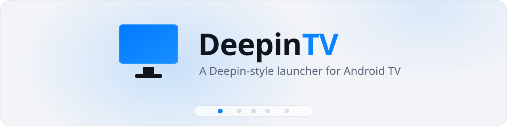
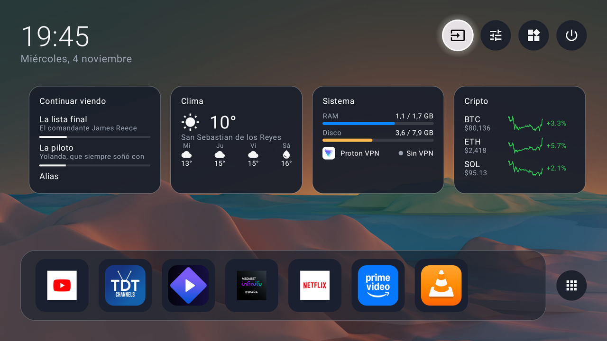
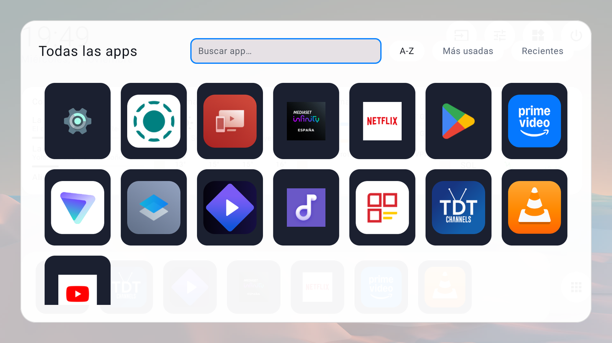
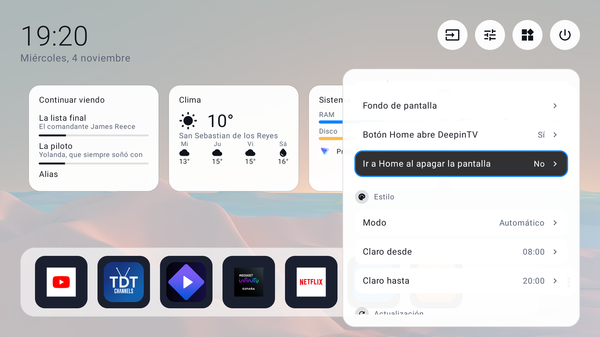
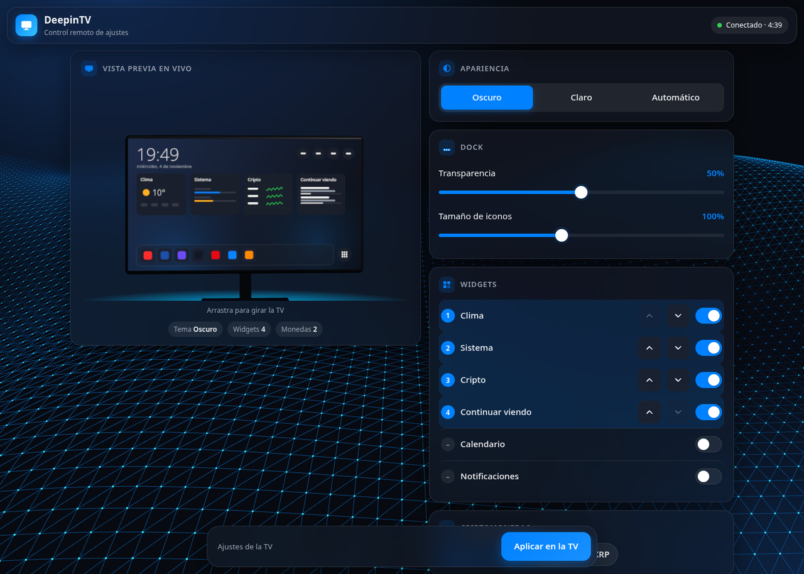
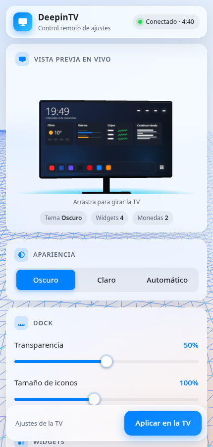

<p align="center">
  <picture>
    <source media="(prefers-color-scheme: dark)" srcset="docs/assets/banner-dark.svg">
    
  </picture>
</p>

<p align="center">
  <a href="../../releases"></a>
  
  
  
  <a href="LICENSE"></a>
</p>

<p align="center">
  <b>English</b> · <a href="README.es.md">Español</a>
</p>

<p align="center">
  Frosted-glass tiles, a bottom dock and a right-side control center —<br>
  the <a href="https://www.deepin.org">Deepin</a> desktop look, rebuilt as a native launcher for low-RAM TVs.
</p>

<p align="center">
  <picture>
    <source media="(prefers-color-scheme: light)" srcset="docs/screenshots/home-light.png">
    
  </picture>
</p>

<br>

## Features

| | | |
|:--|:--|:--|
| 🏠 **Home**<br><sub>Clock, quick pills and an editable dock of favourites.</sub> | 🔎 **App drawer**<br><sub>Search by prefix, word or initials (“gm” → Google Maps). A–Z, most used, recent.</sub> | 🔌 **Inputs**<br><sub>Your own source names, an icon per connector and what is plugged in.</sub> |
| 🧩 **Widgets**<br><sub>Weather, calendar (ICS), system + VPN, crypto, Continue watching, Notifications.</sub> | 🎛️ **Control center**<br><sub>Volume, audio outputs, sleep timer, RAM cleanup, wallpapers, key remap, themes, backup.</sub> | 📱 **Set up from your phone**<br><sub>Scan a QR: a Deepin-style dashboard with a live 3D preview of your Home.</sub> |

<sub>Also: ambient clock screensaver · 7 languages (es, en, fr, it, ja, pt-BR, zh) · safe mode after repeated crashes · optional “go Home when the screen turns off”.</sub>

<p align="center">
  
  &nbsp;
  
</p>
<p align="center">
  
  &nbsp;
  
</p>

<br>

## Install

You need an Android TV / Google TV with **Android 8.0+** and **network debugging (ADB)** enabled in developer
options. Nothing outside the app is changed.

**1 ·** Download `DeepinTV-v0.5.apk` from [**Releases**](../../releases).

**2 ·** Install and precompile it (without the last line the TV runs it interpreted for a while and it feels slow):

```sh
adb connect <tv-ip>:5555
adb -s <tv-ip>:5555 install -r DeepinTV-v0.5.apk
adb -s <tv-ip>:5555 shell cmd package compile -m speed-profile -f com.deepintv.launcher
```

**3 ·** Open it from the apps list, or make it your Home:

```sh
adb shell cmd package set-home-activity com.deepintv.launcher/.MainActivity
```

> [!NOTE]
> **v0.5 — early, and tested on one TV only** (TCL Smart TV Pro G10, Android 12, 1.8 GB RAM).
> If you try it on another set, please tell me what breaks with the
> [bug report template](../../issues/new/choose): TV model, Android version, RAM and what happened.

<br>

<details>
<summary><b>Optional extras and going back</b></summary>
<br>

- Some TVs (Google TV) still open their own launcher with the Home button. Turn on the **DeepinTV accessibility
  service** (Settings → Accessibility) and Home brings DeepinTV back.
- Open it from the PC: `adb shell am start -n com.deepintv.launcher/.MainActivity`.
- **Notifications** widget: grant notification access.
- **Continue watching** widget: `adb shell pm grant com.deepintv.launcher android.permission.READ_TV_LISTINGS`
  (or tap “Grant” in the widget's edit sheet).

**Going back:** `adb shell cmd package set-home-activity <your original launcher>` or simply
`adb uninstall com.deepintv.launcher`.

Release APKs are signed with the maintainer's key; its SHA-256 certificate fingerprint is in each release's notes
(`apksigner verify --print-certs DeepinTV-*.apk`). A build you compile yourself is signed with your debug key, so it
cannot update a release install (uninstall first, and back up your settings from the control center).

</details>

<details>
<summary><b>What we built, and how</b></summary>
<br>

This project was developed step by step with an AI coding assistant (Claude Code), tested on a real TV over ADB,
with a rule that **performance and function improve but the look does not change** (colours, radii, alpha, glow
and typography are fixed).

| Phase | What it did |
|---|---|
| 0 | Clean start: first working launcher committed, versioned, README. |
| 1 – Performance | Baseline Profile + R8 (cold start **2.7 s → 0.45 s**, memory **68 → ~40 MB PSS** on the TV), apps and icons loaded off the main thread, downsampled wallpapers and icon cache, a LIGHT/FULL device profile that lowers refresh work on small TVs, lighter accessibility events. |
| 2 – Robustness | Live Wi-Fi and volume, app list that follows installs/uninstalls, retries with back-off and "old data" notes for network widgets, safe mode after 3 crashes in 5 minutes, key remap that swallows key-up/repeat, vector weather icons (the TCL G10 has no emoji font), unit tests. |
| 3 – Features | App search, recent apps, richer HDMI inputs, Continue watching, Notifications, configuration from the phone by QR. |
| 4 – Polish | TV banner, optional "go to Home on screen off", black text in the search field, the 3D phone dashboard. |

Along the way several TV-specific bugs were found and fixed with real key events (D-pad focus escaping the drawer,
long-press timing, the TV's keyboard swallowing Back). 68 unit tests run on the plain JVM.

</details>

<details>
<summary><b>Privacy and network</b></summary>
<br>

- No account, no analytics, no ads. Settings stay on the TV.
- Contacts, only for widgets you enable: [Open-Meteo](https://open-meteo.com) (weather and city search),
  [CoinGecko](https://www.coingecko.com) (crypto prices), your calendar's ICS URL, and `ipwho.is` once to guess your
  city if you never chose one.
- The Notifications widget keeps only title and text of the last 20 notifications **in memory** and is off by default.
- The phone-configuration server runs only while its QR is on screen: one-time code valid 5 minutes, tied to the
  phone that scans it, local network only, and it closes after the first change.

</details>

<details>
<summary><b>Security</b></summary>
<br>

- The phone page is plain **HTTP on your local network**: someone on the same Wi-Fi could see the one-time code. It
  is only valid for 5 minutes, for one phone, and the server stops after the first change or five failed attempts
  (if that happens, just open a new QR). Use it on a network you trust.
- The **accessibility service** is optional. It only listens for window changes (to send the Home button to
  DeepinTV) and remote keys; it never reads screen content. The **notification access** is optional too, and
  notifications stay in memory.
- Downloads are size-limited and https only. No exported component can be used by other apps without a system
  permission.
- Found a security problem? Please open a [private security advisory](../../security/advisories/new) instead of a
  public issue.

</details>

<details>
<summary><b>Build from source</b></summary>
<br>

```sh
export JAVA_HOME=~/Android/jdk17        # JDK 17
./gradlew assembleRelease testDebugUnitTest lint
```

Output: `app/build/outputs/apk/release/app-release.apk`, signed with your debug key. To sign with your own key, copy
`keystore.properties.example` to `keystore.properties` (git-ignored) and fill it in.

The phone page's 3D scene is generated: after editing `web/scene.js` run `cd web && npm install && npm run build`
(it bundles the needed parts of [three.js](https://threejs.org) into `app/src/main/res/raw/config_scene.js`).

</details>

<details>
<summary><b>Projects we took ideas from</b></summary>
<br>

DeepinTV is a **separate, independent project**. These repositories were read for ideas; where code or techniques
were adapted the original licences are respected (see [THIRD_PARTY_NOTICES.md](THIRD_PARTY_NOTICES.md)):

- [Gathin23/cleanyourtv](https://github.com/Gathin23/cleanyourtv) (MIT) — the TCL debloat/launcher toolkit that
  started this project: connecting to the TV over ADB, backing it up and debloating it safely. Its notes on TCL
  quirks were the reference for the TCL-specific fixes.
- [cookedzera/aura-tv](https://github.com/cookedzera/aura-tv) (MIT) — app search ranking, device tiers, safe mode
  after crash loops, Watch Next notes.
- [pengchujin/aerial-tv](https://github.com/pengchujin/aerial-tv) (MIT) — why TVs feel slow before profile
  compilation and how to avoid it.
- [Jarvis322/matinee](https://github.com/Jarvis322/matinee) (MIT Kotlin parts; its native `cpp/` code is GPL-3 and
  was **not** used) — device profile, HDMI input catalogue, protected-package lists.
- [MoonTechLab/Selene-TV](https://github.com/MoonTechLab/Selene-TV) — ideas only; it has no licence, so **no code**
  was taken.
- The look follows the [Deepin](https://www.deepin.org) desktop (glass, rounded corners, blue accent).

</details>

<br>

<p align="center">
  <sub>
    <a href="LICENSE">MIT License</a> · <a href="THIRD_PARTY_NOTICES.md">Third-party notices</a><br>
    DeepinTV is not affiliated with or endorsed by Deepin.
  </sub>
</p>
